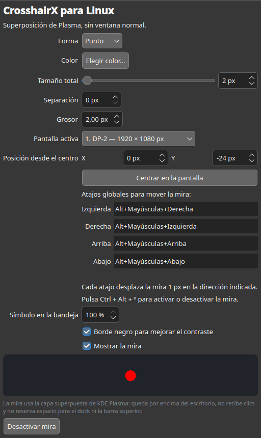
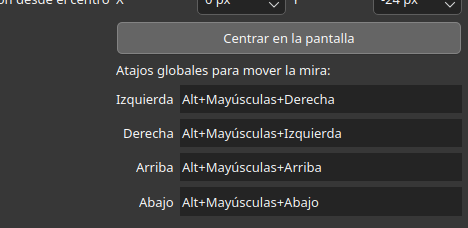

# CrosshairX para Linux

**Versión 1.0.0.** Una mira configurable para juegos en KDE Plasma sobre
Wayland. Permite ajustar forma, color, tamaño, pantalla y posición; incluye
atajos globales configurables para mover la mira y un icono de bandeja. La
configuración está hecha con Python y PyQt6, y la mira se dibuja mediante una
superficie LayerShellQt del compositor.

## Capturas de pantalla





## Ejecutar

```bash
python3 ./crosshair.py
```

Requiere Python 3, PyQt6, Qt 6, CMake y LayerShellQt. Compila el renderizador
una vez con:

```bash
./build.sh
```

Después ejecuta la aplicación. La configuración se guarda en
`~/.config/crosshairx-linux/settings.json`.

También se puede abrir desde el menú de aplicaciones como **CrosshairX para
Linux**.

## Instalación

Para instalarla para tu usuario, ejecuta:

```bash
chmod +x install.sh
./install.sh
```

Consulta [INSTRUCCIONES.txt](INSTRUCCIONES.txt) para los requisitos por
distribución, la instalación de sistema y la desinstalación.

## Uso

La ventana permite elegir forma, color, tamaño total desde 1 px, separación,
grosor en pasos de 0,25 px, borde, pantalla, posición X/Y y visibilidad. El
botón «Centrar en la pantalla» vuelve a poner ambos desplazamientos a cero. Los
cambios se guardan automáticamente.

Con la mira visible, los atajos configurados en la sección «Posición desde el
centro» desplazan la posición un píxel en la dirección indicada. Cada dirección
se puede asignar a una combinación distinta; los valores iniciales son `Home`,
`End`, `Page Up` y `Page Down`. Los desplazamientos se reflejan en los controles
X/Y y se guardan en la configuración. Los cambios de atajo se aplican sin
reiniciar la aplicación.

`Ctrl` + `Alt` + `º` alterna la visibilidad de la mira desde cualquier
aplicación. En algunos teclados `Fn` no se transmite como modificador separado;
los atajos configurables permiten elegir combinaciones que no dependan de esa
tecla.

El icono blanco y transparente de la bandeja alterna la mira con un clic
izquierdo. El menú contextual permite abrir la configuración, activar o
desactivar la mira y cerrar la aplicación. Cerrar la ventana de configuración
la oculta en la bandeja sin detener la mira.

## KDE Plasma y Wayland

La mira se crea como superficie de capa `Overlay`, anclada al área completa de
la pantalla elegida. No es una ventana normal: no recibe entrada del ratón ni
teclado y reserva cero espacio exclusivo, por lo que el dock y la barra superior
conservan su área y reciben los clics. Su posición central se calcula desde el
centro físico de la salida, sin restar el espacio de los paneles. Las superficies
de capa pertenecen a la salida del compositor, no a un escritorio virtual.

La prioridad visual depende de las reglas del compositor y de otras superficies
de sistema; no puede forzarse por encima de pantallas de bloqueo o avisos seguros.
La aplicación requiere una sesión KDE Plasma Wayland y LayerShellQt instalado.

Este proyecto no inyecta código en juegos ni modifica sus archivos.
